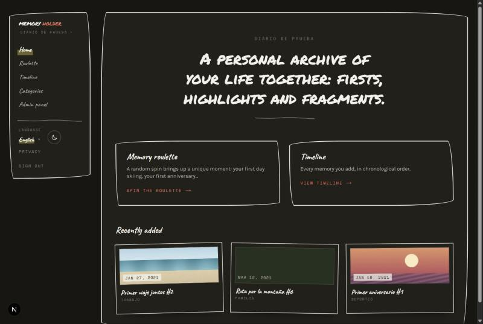
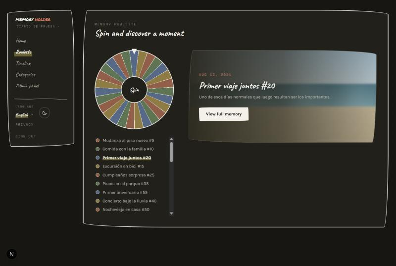
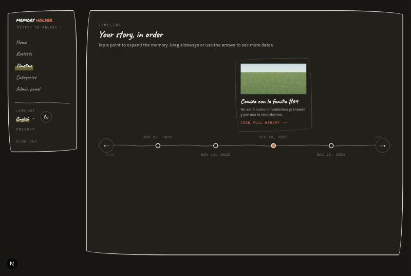
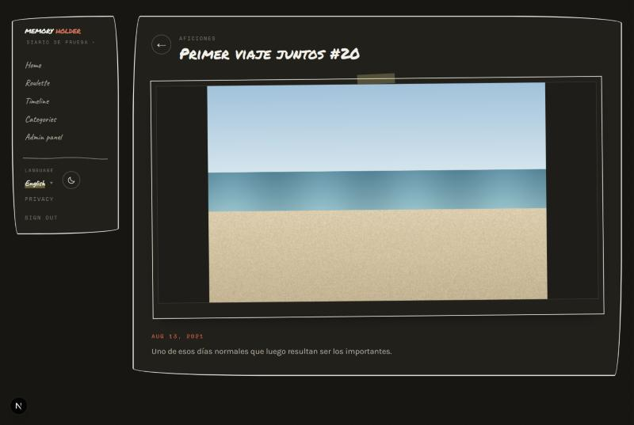

# Memory Holder

A shared digital diary — a roulette of memories, a timeline, and topic categories
(trips, work, hobbies, sport…) for photos and videos. One account can hold several
diaries: one with a partner, one with family, one with friends, each private to its
own members and invisible to everyone else.

Built to be generic: the app ships with no content of its own, and everyone who
signs up fills their own.

Available in English, Spanish, and Chinese (switchable from the UI, no reload
needed).

## Try it

The app is live at [memory-holder.com](https://memory-holder.com). The front page
has a **see how it works** button that hands you a diary of your own, copied from
one full of invented memories: no account, no email, write and delete whatever you
like. It is deleted that night. See [`docs/demo.md`](docs/demo.md) for how it is
built and why the limits are in the database rather than in the interface.

Everything else is private to its members, so the screenshots below are what the
app looks like once you're inside one.

| | |
| --- | --- |
|  |  |
|  |  |

The diary in these shots is seeded with
[`supabase/seed/demo-diary.sql`](supabase/seed/demo-diary.sql) and the photos are
generated placeholders, not anyone's real ones.

## What's in it

- **Roulette, timeline and categories** — three ways into the same memories. The
  timeline magnifies under the cursor and opens cards without a click.
- **Full-text search** across titles, descriptions and bodies, accent-insensitive
  and working in Chinese, which a Postgres text search parser can't split.
- **Several diaries per account**, with an invite code each, and a way out of one.
- **Installable on a phone**, with an offline shell and a photo cache, so a diary
  opened before the signal went still opens.
- **A memory every Sunday by email**, one per diary, with a working unsubscribe.
- **Export the whole diary** as a zip: a readable HTML page, the photos, and the
  raw JSON.
- **Weekly off-site backups** of both the database and the photos, encrypted.
- **An account cap** you raise by hand, because one person pays for the thing.

## Stack

- **Next.js 16** (App Router, Server Actions, Turbopack)
- **Supabase** — Postgres, Auth, and Storage, with Row Level Security enforcing that
  a diary's data is only ever visible to its own members
- **Tailwind CSS v4** for styling, **next-intl** for translations
- Deploy target: Vercel (app) + Supabase (database/auth/storage), with GitHub
  Actions as the scheduler for everything that has to happen on a timer

See [`docs/architecture.md`](docs/architecture.md) for how these fit together, and
[`docs/data-model.md`](docs/data-model.md) for the database schema.

## Getting started

### 1. Create a Supabase project

Create a project at [supabase.com](https://supabase.com), then open the SQL Editor
and run the files in [`supabase/migrations/`](supabase/migrations) **in order**,
0001 to 0009. Each one is a step the app depends on:

| | |
| --- | --- |
| `0001_init.sql` | Every table, the RLS policies, the `create_couple` / `join_couple_by_code` functions behind onboarding, and the private `media` bucket. |
| `0002_editing_presence.sql` | The realtime channel that stops two people editing one memory at once. |
| `0003_leave_diary.sql` | Leaving a diary, and what happens to it when the last member goes. |
| `0004_delete_account.sql` | Closing an account and taking its data with it. |
| `0005_account_limit.sql` | The cap on how many accounts may exist. |
| `0006_search.sql` | Trigram index and the accent-folding needed to search. |
| `0007_weekly_email.sql` | Who is due a Sunday email, and the unsubscribe token. |
| `0008_demo_account.sql` | The read-only account that owns the demo's template diary. |
| `0009_sandbox.sql` | The try-it diaries: building them, limiting them, deleting them. |

The last two are only needed if you want the public demo. If you do, read
[`docs/demo.md`](docs/demo.md) first — there's an order to it, and a Supabase
setting to switch on.

If you have the [Supabase CLI](https://supabase.com/docs/guides/local-development/cli/getting-started)
set up instead, `supabase db push` applies them all.

### 2. Configure environment variables

```bash
cp .env.example .env.local
```

`NEXT_PUBLIC_SUPABASE_URL` and `NEXT_PUBLIC_SUPABASE_ANON_KEY` come from your
Supabase project's **Settings → API** page, and are all you need to run the app
locally. The rest of [`.env.example`](.env.example) is for the pieces that run on a
schedule — the Sunday email, the backups, the nightly demo cleanup — and each is
documented where it is used.

### 3. Set up the auth emails

Sign-ups are confirmed by email, and the stock Supabase setup doesn't work for
this app — its template returns the session in a URL fragment, which a
server-rendered app never sees, so the link looks dead. Three things to change:

1. **Custom SMTP.** Under **Project Settings → Authentication → SMTP Settings**,
   point Supabase at a real sender (Resend, Brevo, SES…) and verify the sending
   domain. Supabase's built-in sender is capped at
   [2 emails per hour for the whole project](https://supabase.com/docs/guides/auth/rate-limits),
   which is fine while developing and nowhere near enough in production.
2. **URL configuration**, under **Authentication → URL Configuration**: set the
   Site URL to the live site, and add `/auth/confirm` on every host the app runs
   on to the Redirect URLs, including `http://localhost:3000/auth/confirm`.
3. **Templates.** Paste [`supabase/emails/confirm-signup.html`](supabase/emails/confirm-signup.html)
   into **Authentication → Emails → Confirm signup**, and
   [`supabase/emails/reset-password.html`](supabase/emails/reset-password.html) into
   **Reset password**. Both link to [`/auth/confirm`](src/app/auth/confirm/route.ts),
   which exchanges the token for a session server-side.

### 4. Install and run

```bash
npm install
npm run dev
```

Open [http://localhost:3000](http://localhost:3000). The first visit will ask you to
sign up, then either create a new diary (which generates an invite code) or join one
with a code someone shared with you.

## Project structure

```
src/
  app/
    page.tsx                         — the front page, signed out
    login/, signup/, onboarding/     — auth + first-run flow (own layout, no nav)
    account/password/, auth/confirm/ — password change and email confirmation
    sandbox/actions.ts               — starts a try-it diary (docs/demo.md)
    (app)/                           — everything behind requireCoupleContext()
      layout.tsx                     — nav rail / bottom bar shell + auth guard
      home/, roulette/, timeline/, categories/, search/
      memories/[memoryId]/           — memory detail; reachable from roulette,
                                        timeline, search or a category, never nav
      admin/                         — memories/categories CRUD, invite code,
                                        account, export, leaving a diary
    api/
      export/                        — the whole diary as a zip
      weekly-digest/                 — the Sunday email, called by GitHub Actions
      unsubscribe/[token]/           — one-click unsubscribe (RFC 8058)
      sandbox-cleanup/               — deletes last night's try-it diaries
    media/[mediaId]/                 — signed URLs for private photos
    manifest.ts, app-icon/, icon.svg — installable-app metadata
  components/                        — shared UI (nav, carousels, form fields…)
  lib/
    supabase/                        — browser/server/admin Supabase clients
    data/                            — data-access helpers (Server Component-only)
    types/database.ts                — hand-written types matching the SQL schema
  i18n/                              — locale cookie, next-intl request config
messages/{en,es,zh}.json             — UI strings (en is the source language)
public/sw.js, offline.html           — service worker: app shell + photo cache
supabase/migrations/                 — SQL schema + RLS policies
.github/workflows/                   — the scheduled jobs (backup, Sunday email,
                                       nightly demo cleanup, keeping Supabase awake)
docs/                                — architecture, data model, deployment,
                                       backups, the Sunday email, the demo
```

## Notes on the current state

- Deleting a single memory leaves its photos in Storage. The database rows cascade,
  but nothing removes the files, and SQL can't reach the bucket. Deleting a photo
  on its own does clean up, as do closing an account and leaving the last diary.
- No automated tests yet.
- `public/` still carries a few SVGs from the Next.js starter that nothing uses.

## License

[MIT](LICENSE). The code is yours to reuse; the diaries people keep in a running
instance are not.
